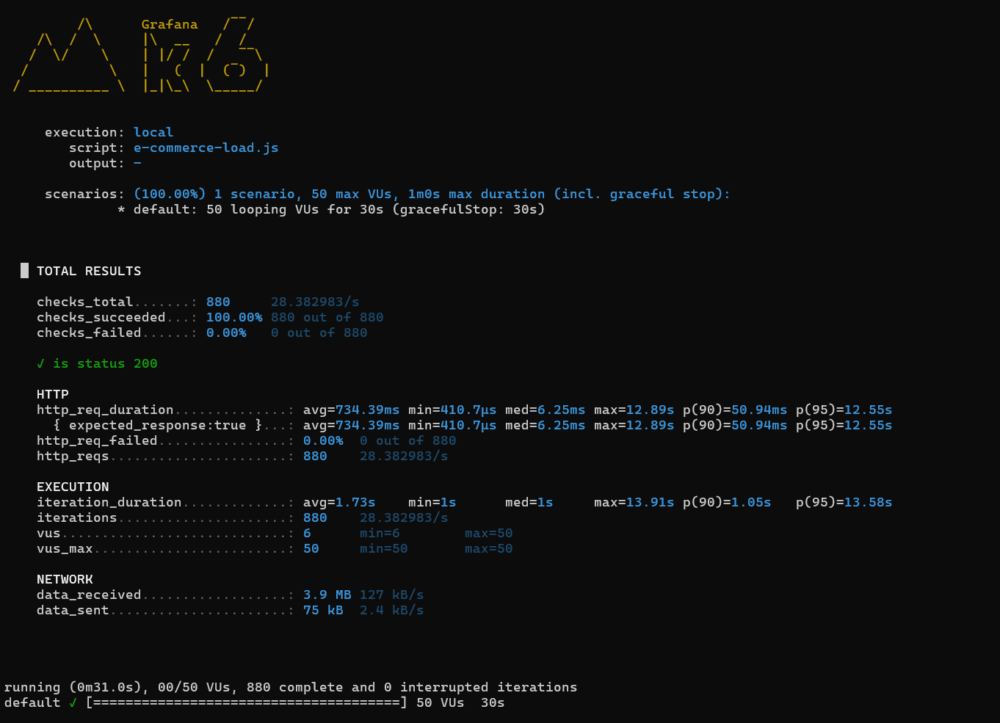

## 📊 API Load Testing
For demonstration purposes, a load test was performed on the **Get Products API** (`GET /api/v1/products`) using **k6** to simulate a sustained load of 50 virtual users for 30 seconds.

### Test Output

